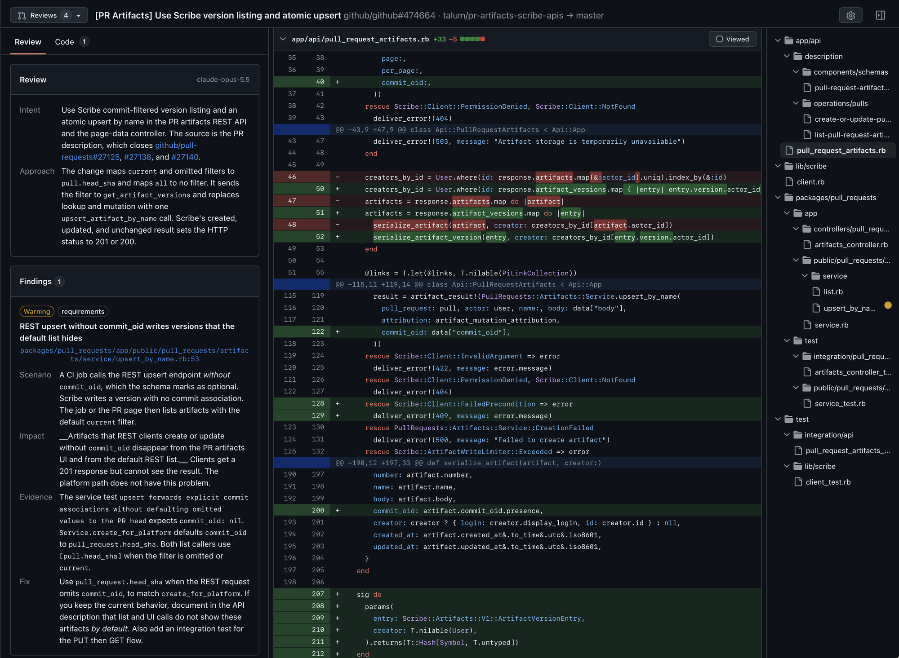
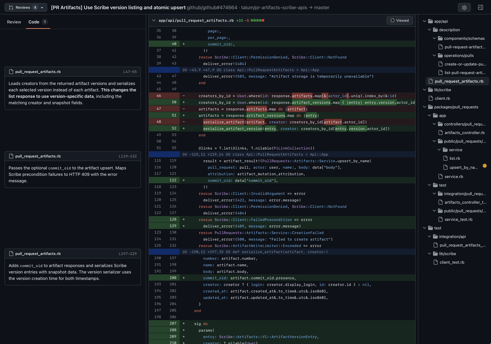

# PR Review

A GitHub Copilot canvas for reviewing pull requests beside their code changes.

- **Review:** a larger model explains the intent and reports risks with evidence and suggested fixes.
- **Code:** a smaller model explains each hunk. Findings appear beside the relevant lines.
- **Ask Copilot:** ask questions about a finding, hunk explanation, or code line, with context added automatically.

Includes syntax highlighting, unified and split diffs, a collapsible file tree, stack navigation, and saved reviews. Settings control models and test-file visibility.

## Use

Requires the GitHub Copilot app with canvas extensions and an authenticated GitHub CLI (`gh`).
Ask Copilot to open a PR in the **PR Review** canvas. Choose models in Settings, then select **Analyze**.
The canvas does not post review comments to GitHub.

Reviews are local snapshots. If a conversation cannot be saved, keep the canvas open and select **Retry save**.

## Screenshots

### Review

### Code

